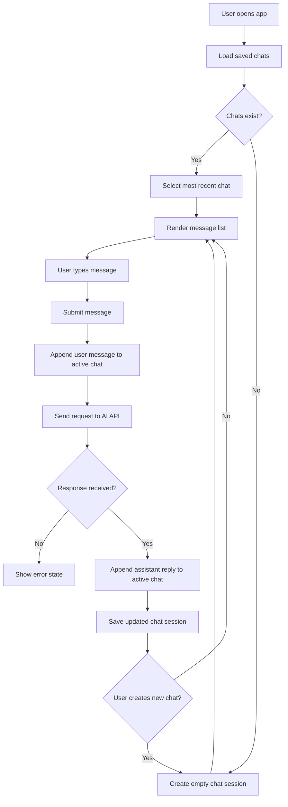
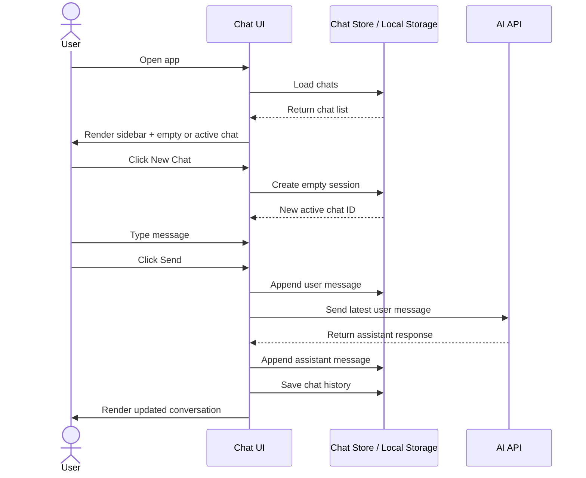

# AskFolio

## Product goal
AskFolio is a simple AI chat application where a user can:
- view a list of previous chats,
- open an existing chat,
- create a new chat,
- send a message,
- receive an AI reply,
- continue a conversation in the same thread.

This version targets an MVP that is easy to implement and easy to evolve.

## MVP
The home screen contains:
- Header with brand/logo and main navigation
- Sidebar with a list of saved chats
- Main panel with:
  - chat title/header
  - message list
  - input box with send button
  - empty state for a brand-new chat

### Primary behaviors
- User opens the app.
- Sidebar loads previously created chats if any exist.
- User can start a new chat.
- User can click an existing chat in the sidebar to open it.
- User types a message and sends it.
- The app adds the user message to the active chat immediately.
- The app makes a request to the AI backend.
- The assistant response is appended to the same chat.
- The conversation remains stored for future access.

## Recommended data model
A chat should represent a conversation thread, not alternating user/bot objects.

```ts
interface Message {
  id: string;
  role: 'user' | 'assistant';
  content: string;
  createdAt: string;
  status?: 'pending' | 'sent' | 'streaming' | 'error';
}

interface ChatSession {
  id: string;
  title: string;
  messages: Message[];
  updatedAt: string;
}
```

Example:

```ts
const chats: ChatSession[] = [
  {
    id: 'chat_123',
    title: 'Project planning',
    updatedAt: '2026-10-30T10:00:00.000Z',
    messages: [
      { id: 'm1', role: 'user', content: 'Help me plan a launch', createdAt: '...' },
      { id: 'm2', role: 'assistant', content: 'Sure — here is a plan...', createdAt: '...' }
    ]
  }
];
```

This structure supports:
- multi-turn conversations,
- future message editing,
- streaming responses,
- deleting or restoring chat history,
- persistence in local storage or backend storage.

## Suggested app state lifecycle

```ts
type ActiveChatState = {
  chats: ChatSession[];
  activeChatId: string | null;
  isLoading: boolean;
  isSending: boolean;
  error: string | null;
};
```

### State flow
1. App initializes.
2. Load saved chats from local storage or API.
3. If chats exist, select the most recent one.
4. If no chats exist, create an empty chat session.
5. User sends a message.
6. Append user message to active chat.
7. Set `isSending = true`.
8. Send message to AI API.
9. When the response returns, append assistant message.
10. Save chat list.
11. Reset loading state.

## UI layout

### Desktop
- Left sidebar for chat history
- Right main panel for conversation
- Header with current chat title and new chat action

### Mobile
- Sidebar can collapse into a drawer or slide-over panel
- Main conversation stays full width
- New chat button remains visible in the header or floating action button

## Flow diagram



## Sequence diagram



## MVP acceptance criteria
- User can create a new chat.
- User can open a previous chat.
- User can send a message and receive a reply.
- Messages persist after refresh for the MVP stage.
- The app does not lose the active conversation state while switching chats.
- The sidebar reflects the current list of chats.

## Recommended next implementation step
Start by implementing:
1. chat session model,
2. chat list state,
3. message rendering,
4. new chat creation,
5. send-message flow,
6. local persistence,
7. AI backend integration.

This keeps the MVP realistic and avoids building a fragile chat flow around temporary message objects.


