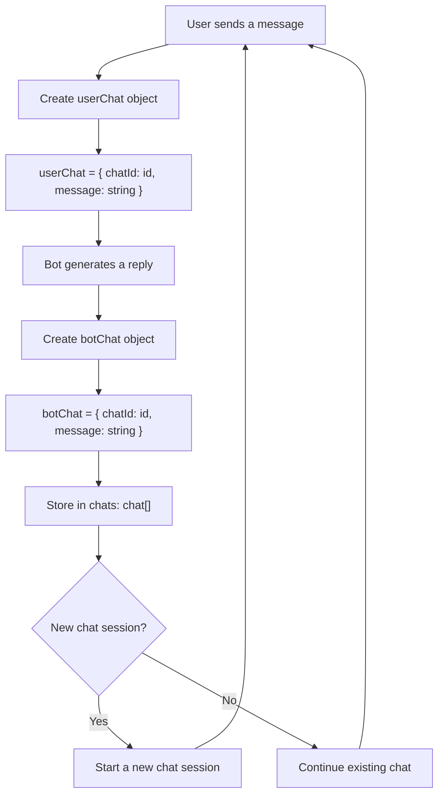
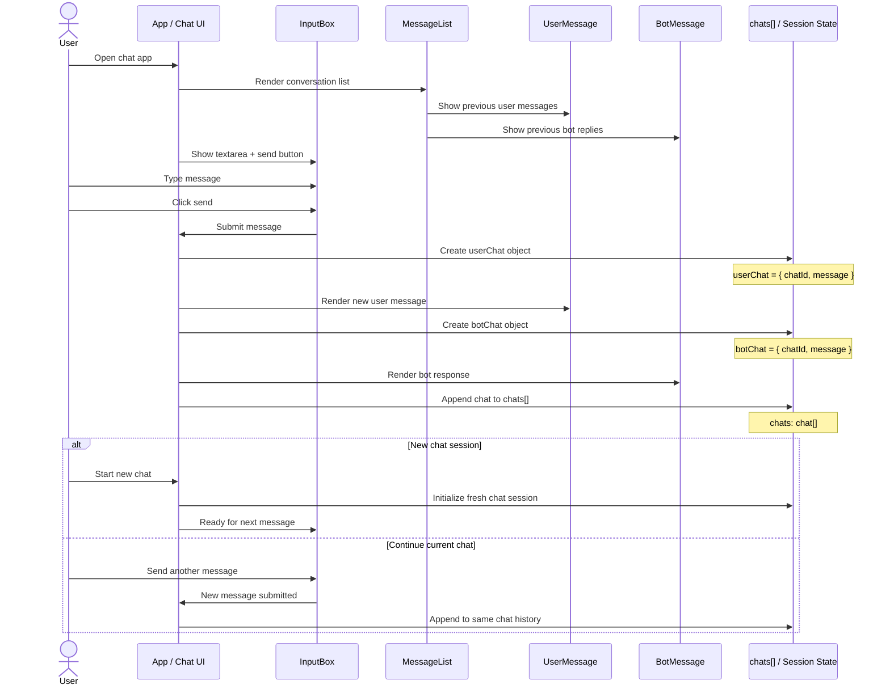

# AskFolio

## MVP
The main/home page contains:
- Header with logo, main navigation
- Side bar with list of chats if exist
- Main area: 
  - Message list, display a welcome message
  - Search box, blank and user start a new chat.

The user sends a message, then the bot answers.
It continues in a number of chats.

The user may start a new chat session. Then the old chat is stored and a new chat starts. The same pattern continues.

The chat history is listed in the Side bar on desktop version. On Mobile it is not decided.
User click on one of the link and it opens the chat.
User may click on "new chat" and new blank chat box and chat area opens.

- chat = {
  userChat: {
    chatId: id,
    message: string
  },
  botChat: {
    chatId: id,
    message: string
  }
}

chats: chat[];

### Mermaid Diagram

### Sequence Diagram

